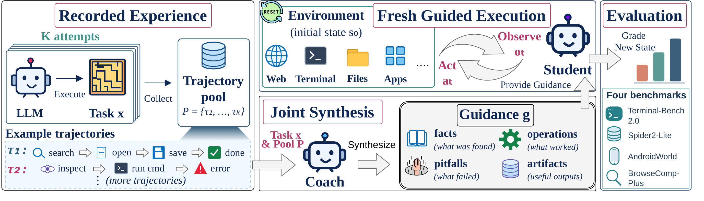
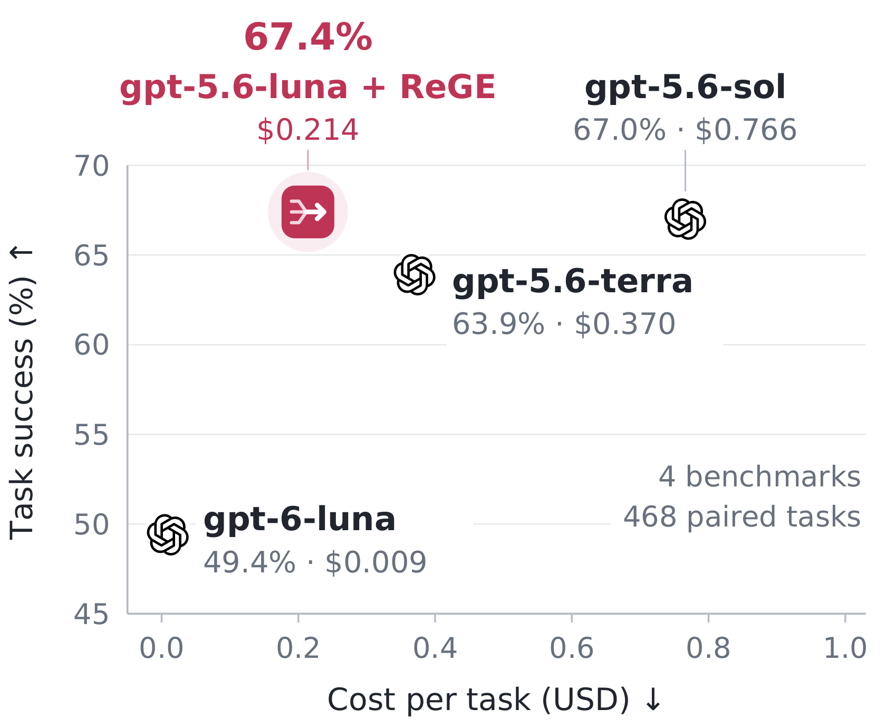

<div align="center">

# ReGE

### Stronger Agents through Experience Synthesis

[Jiarong Liang](https://dream233.github.io/)<sup>1</sup> · Yubo Wang<sup>1</sup> · Zijie Liu<sup>2</sup> · Yuxuan Zhang<sup>3</sup> · Ping Nie<sup>1</sup> · [Wenhu Chen](https://wenhuchen.github.io/)<sup>1</sup>

<sup>1</sup>University of Waterloo · <sup>2</sup>University of North Carolina at Chapel Hill · <sup>3</sup>University of British Columbia

[**🌐 Homepage**](https://tiger-ai-lab.github.io/ReGE/) | [**📄 Paper**](https://arxiv.org/abs/2610.33861) | [**𝕏 X**](https://x.com/JLiang51825/status/2115153311292915976) | [**💼 LinkedIn**](https://www.linkedin.com/posts/jiarong-liang-b2a8a5239_aiagents-llm-machinelearning-share-7520920602505969665-a3mM/)

</div>

## 🔔 News

- **[2026-10]** 🔥 Our paper is on [arXiv](https://arxiv.org/abs/2610.33861). The [homepage](https://tiger-ai-lab.github.io/ReGE/) and the code for reproducing the paper are released.

## Overview

Repeated attempts at an interactive task uncover facts, working operations and failures that a single run can miss.
**ReGE** (*Re-execution Guided by Experience*) turns these recorded attempts into guidance for a fresh attempt by the
same model, so a lower-priced model guided by its own attempts can match higher-priced models.

- **Joint synthesis in one call.** ReGE-Syn gives a coach the bounded execution records and final artifacts of all
  recorded attempts together and asks for one self-contained plan in execution order, with the exact paths, values,
  commands and pitfalls placed at the steps where they matter. Correctness labels are withheld from the coach.
- **A fresh execution.** The student starts from the task's initial environment state. Files and state from the
  earlier attempts do not carry over, so it follows, adjusts or skips the proposed operations against what it
  observes.
- **One base model.** Source attempts, synthesis and execution use the same model, with no parameter updates and no
  stronger teacher. The second implementation, ReGE-Sel, forwards one judge-selected trajectory as the guidance.

<p align="center">
  
</p>

## Results

We evaluate on Terminal-Bench 2.0, Spider2-Lite, AndroidWorld and BrowseComp-Plus. Each task has a pool of four source attempts; ReGE and AggAgent share these pools, and each gets one
fresh student execution under the same benchmark-specific step limit.

- **Higher task success.** Across the four benchmarks, ReGE improves mean task success over unguided execution by 9.9
  percentage points with GPT and 8.8 with Claude.
- **A lower-priced model matches higher-priced ones.** On a 468-task subset, `gpt-5.6-luna` with ReGE reaches 67.4%
  average success, against 67.0% for `gpt-5.6-sol` and 63.9% for `gpt-5.6-terra`, at 28% and 58% of their cost per
  task including source-pool generation. The newer, lower-priced `gpt-6-luna` costs less but reaches 49.4%.
- **Cheap guidance.** On matched BrowseComp-Plus queries, ReGE-Syn spends 98.2% (GPT) and 95.5% (Claude) fewer
  guidance-construction tokens than adapted AggAgent, and 15.7% and 35.4% fewer tokens for construction and execution
  combined (input plus output, excluding source generation).


<p align="center">
  
  <br>
  <sub>With ReGE, <code>gpt-5.6-luna</code> matches <code>gpt-5.6-sol</code> at 28% of its cost. Average task success
  over the 468 tasks of Table 5 against list-price cost per task; the cost of ReGE includes generating the source
  pool.</sub>
</p>

**Table 2.** Task success and source-inclusive token costs across four benchmarks.

<table>
  <thead>
    <tr>
      <th rowspan="2" align="left">Benchmark</th>
      <th colspan="6" align="center">Task success (%)</th>
      <th colspan="6" align="center">Cost (× Control)</th>
    </tr>
    <tr>
      <th align="center">Control</th><th align="center">SC</th><th align="center">Best-of-N</th><th align="center">Reflexion</th><th align="center">AggAgent</th><th align="center">ReGE (ours)</th>
      <th align="center">Control</th><th align="center">SC</th><th align="center">Best-of-N</th><th align="center">Reflexion</th><th align="center">AggAgent</th><th align="center">ReGE (ours)</th>
    </tr>
  </thead>
  <tbody>
    <tr><th colspan="13" align="left"><code>gpt-5.6-luna</code></th></tr>
    <tr><td>Terminal-Bench 2.0</td><td align="center">41.6</td><td align="center">—</td><td align="center"><ins>54.0</ins></td><td align="center">46.1</td><td align="center">46.1</td><td align="center"><b>56.2</b></td><td align="center">1.00</td><td align="center">—</td><td align="center">4.17</td><td align="center">2.71</td><td align="center">5.83</td><td align="center">5.25</td></tr>
    <tr><td>Spider2-Lite</td><td align="center">59.3</td><td align="center"><ins>64.4</ins></td><td align="center">63.7</td><td align="center"><ins>64.4</ins></td><td align="center">55.6</td><td align="center"><b>66.7</b></td><td align="center">1.00</td><td align="center">4.00</td><td align="center">4.32</td><td align="center">1.50</td><td align="center">11.71</td><td align="center">5.36</td></tr>
    <tr><td>AndroidWorld</td><td align="center">53.8</td><td align="center">—</td><td align="center"><ins>57.9</ins></td><td align="center">55.3</td><td align="center">51.5</td><td align="center"><b>58.8</b></td><td align="center">1.00</td><td align="center">—</td><td align="center">4.02</td><td align="center">2.30</td><td align="center">4.92</td><td align="center">5.06</td></tr>
    <tr><td>BrowseComp-Plus</td><td align="center">64.1</td><td align="center">74.0</td><td align="center">74.0</td><td align="center">73.3</td><td align="center"><ins>76.1</ins></td><td align="center"><b>76.6</b></td><td align="center">1.00</td><td align="center">4.00</td><td align="center">4.01</td><td align="center">2.09</td><td align="center">4.74</td><td align="center">4.52</td></tr>
    <tr><td><b>Average</b></td><td align="center">54.7</td><td align="center">—</td><td align="center"><ins>62.4</ins></td><td align="center">59.8</td><td align="center">57.3</td><td align="center"><b>64.6</b></td><td align="center">1.00</td><td align="center">—</td><td align="center">4.13</td><td align="center">2.15</td><td align="center">6.80</td><td align="center">5.05</td></tr>
    <tr><th colspan="13" align="left"><code>claude-sonnet-5</code></th></tr>
    <tr><td>Terminal-Bench 2.0</td><td align="center">40.4</td><td align="center">—</td><td align="center">38.2</td><td align="center"><ins>48.3</ins></td><td align="center">46.1</td><td align="center"><b>50.6</b></td><td align="center">1.00</td><td align="center">—</td><td align="center">4.06</td><td align="center">2.62</td><td align="center">6.67</td><td align="center">5.26</td></tr>
    <tr><td>Spider2-Lite</td><td align="center">57.8</td><td align="center">60.0</td><td align="center"><ins>61.5</ins></td><td align="center">59.3</td><td align="center">60.7</td><td align="center"><b>63.7</b></td><td align="center">1.00</td><td align="center">4.00</td><td align="center">4.16</td><td align="center">1.48</td><td align="center">8.75</td><td align="center">5.04</td></tr>
    <tr><td>AndroidWorld</td><td align="center">61.4</td><td align="center">—</td><td align="center">64.9</td><td align="center">61.4</td><td align="center"><ins>65.8</ins></td><td align="center"><b>67.5</b></td><td align="center">1.00</td><td align="center">—</td><td align="center">4.01</td><td align="center">2.07</td><td align="center">5.09</td><td align="center">5.02</td></tr>
    <tr><td>BrowseComp-Plus</td><td align="center">74.3</td><td align="center">84.6</td><td align="center">84.7</td><td align="center">84.5</td><td align="center"><ins>86.3</ins></td><td align="center"><b>87.5</b></td><td align="center">1.00</td><td align="center">4.00</td><td align="center">4.02</td><td align="center">2.14</td><td align="center">4.72</td><td align="center">4.39</td></tr>
    <tr><td><b>Average</b></td><td align="center">58.5</td><td align="center">—</td><td align="center">62.3</td><td align="center">63.4</td><td align="center"><ins>64.7</ins></td><td align="center"><b>67.3</b></td><td align="center">1.00</td><td align="center">—</td><td align="center">4.06</td><td align="center">2.08</td><td align="center">6.31</td><td align="center">4.93</td></tr>
  </tbody>
</table>

<sub>**Task success** in %. **Cost** combines source-generation tokens with measured construction and execution
tokens, relative to Control (×). Bold and underline mark the best and second-best success in each row. **SC** (Self-Consistency) votes
over the source outputs and **Best-of-N** reports the original grade of the judge-selected source; neither
re-executes. **Reflexion** allows up to three executions with label-free self-evaluation. **AggAgent**'s final
response is adapted into guidance for a fresh student. — marks unavailable or inapplicable entries.</sub>

**Table 5.** With ReGE, `gpt-5.6-luna` matches `gpt-5.6-terra` and `gpt-5.6-sol` at lower cost.

<table>
  <thead>
    <tr>
      <th rowspan="2" align="left">Benchmark (tasks)</th>
      <th colspan="5" align="center">Task success (%)</th>
      <th colspan="5" align="center">Cost per task (USD)</th>
    </tr>
    <tr>
      <th align="center">gpt-5.6-luna</th><th align="center">gpt-5.6-luna<br>+ ReGE</th><th align="center">gpt-5.6-terra</th><th align="center">gpt-5.6-sol</th><th align="center">gpt-6-luna</th>
      <th align="center">ReGE<br>incl. pool</th><th align="center">ReGE<br>existing pool</th><th align="center">gpt-5.6-terra</th><th align="center">gpt-5.6-sol</th><th align="center">gpt-6-luna</th>
    </tr>
  </thead>
  <tbody>
    <tr><td>Terminal-Bench 2.0 (44)</td><td align="center">40.9</td><td align="center"><ins>63.6</ins></td><td align="center">59.1</td><td align="center"><b>68.2</b></td><td align="center">34.1</td><td align="center">0.187</td><td align="center"><ins>0.028</ins></td><td align="center">0.251</td><td align="center">0.601</td><td align="center"><b>0.005</b></td></tr>
    <tr><td>Spider2-Lite (68)</td><td align="center"><ins>66.2</ins></td><td align="center"><b>77.9</b></td><td align="center"><ins>66.2</ins></td><td align="center">63.2</td><td align="center"><ins>66.2</ins></td><td align="center">0.043</td><td align="center"><ins>0.007</ins></td><td align="center">0.044</td><td align="center">0.090</td><td align="center"><b>0.001</b></td></tr>
    <tr><td>AndroidWorld (56)</td><td align="center">50.0</td><td align="center">48.2</td><td align="center"><ins>55.4</ins></td><td align="center"><b>57.1</b></td><td align="center">44.6</td><td align="center">0.313</td><td align="center"><ins>0.062</ins></td><td align="center">0.568</td><td align="center">1.138</td><td align="center"><b>0.025</b></td></tr>
    <tr><td>BrowseComp-Plus (300)</td><td align="center">70.0</td><td align="center"><b>80.0</b></td><td align="center">75.0</td><td align="center"><ins>79.3</ins></td><td align="center">52.7</td><td align="center">0.314</td><td align="center"><ins>0.038</ins></td><td align="center">0.615</td><td align="center">1.237</td><td align="center"><b>0.004</b></td></tr>
    <tr><td><b>Average</b></td><td align="center">56.8</td><td align="center"><b>67.4</b></td><td align="center">63.9</td><td align="center"><ins>67.0</ins></td><td align="center">49.4</td><td align="center">0.214</td><td align="center"><ins>0.034</ins></td><td align="center">0.370</td><td align="center">0.766</td><td align="center"><b>0.009</b></td></tr>
  </tbody>
</table>

<sub>The 468 tasks are the first half of Terminal-Bench 2.0, Spider2-Lite and AndroidWorld by task ID (AndroidWorld
templates with their first parameterization) and the 300 BrowseComp-Plus queries of the ablations, paired by task
with the `gpt-5.6-luna` results of Table 2. The other models run once per task without guidance, with the prompts,
tools, step limits and graders of the `gpt-5.6-luna` Control runs and the serving default (medium) reasoning effort.
The cost of ReGE is shown including source-pool generation and
with an existing source pool. Costs use list prices in USD per million input and output tokens: 0.20 and 1.20 for
`gpt-5.6-luna`, 2.00 and 12.00 for `gpt-5.6-terra`, 4.00 and 20.00 for `gpt-5.6-sol`, and 0.10 and 0.50 for
`gpt-6-luna`. Bold and underline mark the best and second-best value in each row and block.</sub>

## Getting started

### Installation

```bash
git clone https://github.com/TIGER-AI-Lab/ReGE.git && cd ReGE
pip install -r requirements.txt
```

The code is a set of scripts run from the repository root with Python 3.11 or newer. Terminal-Bench 2.0 needs Docker,
and AndroidWorld runs in its own Python environment.

### Models

All model calls go through OpenAI-compatible chat completions, and every request to Claude disables extended
thinking. Keys are read from the environment or from a `.env` file at the repository root (`NAME=value` lines).

| Variables | Model | Default endpoint |
|:--|:--|:--|
| `OPENAI_API_KEY`, `GPT_BASE_URL` | `gpt-5.6-luna` (GPT line) | `https://api.openai.com/v1` |
| `ANTHROPIC_API_KEY`, `CLAUDE_SONNET5B_BASE` | `claude-sonnet-5` (Claude line) | `https://api.anthropic.com/v1` |
| `DEEPSEEK_API_KEY` | DeepSeek-V4-Flash (`deepseek-v4-flash`), the BrowseComp-Plus equivalence judge, with reasoning disabled | `https://api.deepseek.com/v1` |
| `LOCAL_API_KEY` | any other endpoint set through the two base-URL variables, e.g. a local gateway | |

### Benchmarks and baselines

| Component | Location | Source |
|:--|:--|:--|
| Terminal-Bench 2.0 | `data/tb2_dataset/terminal-bench/` | `pip install harbor && harbor download terminal-bench@2.0 -o data/tb2_dataset`; Docker pulls each task image on first use |
| Spider2-Lite | `third_party/Spider2` (or `SPIDER2_LITE_DIR` pointing at `spider2-lite/`) | [xlang-ai/Spider2](https://github.com/xlang-ai/Spider2) at `cafb867`, with the local SQLite databases unpacked into `spider2-lite/resource/databases/spider2-localdb/` as its README describes |
| AndroidWorld | Python environment at `ANDROID_WORLD_PYTHON` | [google-research/android_world](https://github.com/google-research/android_world) at `3e50888`, installed in that environment |
| BrowseComp-Plus | `data/bcp/` |  |
| AggAgent | `third_party/AggAgent` (or `AGGAGENT_REPO`) | [princeton-pli/AggAgent](https://github.com/princeton-pli/AggAgent) at `9638f7d`, used unmodified |

### AndroidWorld

Install android_world in a Python 3.11 environment as its README describes, together with the `openai` package, and
point `ANDROID_WORLD_PYTHON` at that interpreter. Create the `AndroidWorldAvd` emulator (Pixel 6, API 33) and run
android_world's one-time app setup on it. `scripts/run_androidworld.sh` drives `LANES` booted emulators (default 6),
each with its own copy of the AVD; lane *i* uses console port `5554 + 2i` and gRPC port `8554 + 2i`, e.g. for lane 0:

```bash
~/Android/sdk/emulator/emulator -avd AndroidWorldAvd -no-window -no-audio -no-snapshot \
    -gpu swiftshader_indirect -port 5554 -grpc 8554
```

Some task checks need SQLite with FTS4. If the environment's `sqlite3` lacks it, install `pysqlite3-binary` and alias
it as `sqlite3` in a `sitecustomize.py`. The two VLC templates, which crash the emulator, are excluded.

### BrowseComp-Plus data

The queries of [Tevatron/browsecomp-plus](https://huggingface.co/datasets/Tevatron/browsecomp-plus) are released
encrypted; decrypt them as described in the [official repository](https://github.com/texttron/BrowseComp-Plus).
Together with the documents of
[Tevatron/browsecomp-plus-corpus](https://huggingface.co/datasets/Tevatron/browsecomp-plus-corpus), `data/bcp/` holds:

| File | Content |
|:--|:--|
| `queries.jsonl` | one decrypted query per line with `query_id`, `query`, `answer`, `gold_docids` and `evidence_docids` |
| `corpus.db` | SQLite table `docs` with the columns `docid` and `text` (as released), one row per document (100,195) |
| `dense/corpus_emb.npy` | Qwen3-Embedding-8B embeddings of the documents, 100,195 × 4,096, L2-normalised, embedded without an instruction |
| `dense/docids.json` | the docid of each embedding row |

Search embeds the query with Qwen3-Embedding-8B, served by vLLM at `BCP_EMB_URL` (default `http://127.0.0.1:8910/v1`):

```bash
vllm serve Qwen/Qwen3-Embedding-8B --runner pooling --port 8910 --max-model-len 8192
```

## Running the pipelines

Each benchmark has one pipeline script. It takes the model line (`gpt` for `gpt-5.6-luna`, `claude` for
`claude-sonnet-5`) and optionally the stages to run, and runs every stage in order when none is named. Run records
go to `data/`, task lists, judge picks, guidance and grades to `result/`, and logs to `logs/`.

```bash
scripts/run_tb2.sh gpt                    # Terminal-Bench 2.0, every stage
scripts/run_spider.sh gpt                 # Spider2-Lite
scripts/run_androidworld.sh gpt           # AndroidWorld
scripts/run_bcp.sh gpt                    # BrowseComp-Plus
scripts/run_tb2.sh claude judge guides    # only the named stages
python scripts/summarize.py               # task success per benchmark and model line -> result/summary.json
```


<details>
<summary>Repository layout</summary>

```
src/                          collectors, guidance construction and graders
  guidance_moa_experiment.py  ReGE-Syn coach prompt, ReGE-Sel guidance, the guidance forms of the ablations and the
                              delivery headers
  aggregate_deliverable.py    source-pool loading, source rendering and the coach call
  judge_sweep.py              ReGE-Sel judge (its picks also give Best-of-N)
  guides_build.py             guidance for every task of a source pool (BrowseComp-Plus)
  aggagent_arm.py             AggAgent adapter (fresh-student guidance from its final response)
  tb2_collect.py              Terminal-Bench 2.0 agent loop and official verifier, with shell helpers from tb_collect.py;
                              tb2_guides.py builds its guidance
  spider_collect.py           Spider2-Lite agent loop and official result comparison (spider_eval_bridge.py);
                              spider_guides_s5.py converts the source pool and builds guidance
  droid_collect.py            AndroidWorld T3A agent and state-based grading; droid_guides_dsE.py converts the source
                              pool and builds guidance
  bcp_collect.py              BrowseComp-Plus search, document and submit tools, and grading
  stitch_validate.py          model registry and API keys
  door_probe.py               request settings that disable Claude's extended thinking
scripts/                      the four pipelines, task lists, merging of parallel builds and the accuracy summary
configs/                      BrowseComp-Plus query order (830 queries)
homepage/                     project page, published to GitHub Pages by .github/workflows/pages.yml
```

</details>

## Citation

If you find ReGE useful, please cite our paper:

<!-- TODO: replace this placeholder with the Google Scholar BibTeX once the paper is indexed (also in homepage/index.html). -->
```bibtex
@article{rege2026,
  title   = {ReGE: Stronger Agents through Experience Synthesis},
  author  = {Liang, Jiarong and Wang, Yubo and Liu, Zijie and Zhang, Yuxuan and Nie, Ping and Chen, Wenhu},
  journal = {arXiv preprint arXiv:2610.33861},
  year    = {2026}
}
```

## License

The code is released under the [MIT License](LICENSE).
